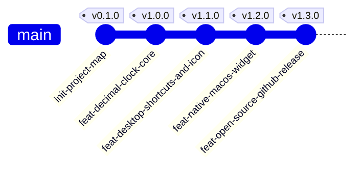

# Reloj Digital de Tiempo Decimal (Système Décimal Révolutionnaire) - Project Map

Aplicación web standalone en un único archivo (`index.html`), 100% autónoma, offline y sin dependencias externas, complementada con un **Widget Nativo para macOS (Swift & AppKit)** que implementa el sistema de tiempo decimal decretado durante la Revolución Francesa (1793): el día dividido en 10 horas decimales, cada hora en 100 minutos decimales y cada minuto en 100 segundos decimales (100.000 unidades/día).

---

## 📊 Grafo de Versiones

---

## 📌 Checkpoints

| ID | Fecha | Versión | Descripción | Estado |
|---|---|---|---|---|
| `CHK-001` | 2026-10-23 | `v0.1.0` | Inicialización del repositorio git y mapa del proyecto | ✅ Completado |
| `CHK-002` | 2026-10-23 | `v1.0.0` | Aplicación web standalone completa (`index.html`) con reloj en tiempo real (`requestAnimationFrame`), protección IEEE-754 contra imprecisiones de punto flotante, panel comparador 24h, porcentaje de día, convertidor interactivo bidireccional, síntesis de audio procedural Web Audio API, diseño Slate Dark Mode responsivo y scripts desacoplados POSIX `start.sh`/`stop.sh` en puerto asignado `5190` | ✅ Completado |
| `CHK-003` | 2026-10-23 | `v1.1.0` | Creación de lanzadores en el Escritorio: aplicación nativa compilada macOS `Reloj Decimal.app` con icono de esfera decimal de 10h personalizado (`.icns`), lanzador por terminal `Reloj Decimal.command` y script desacoplado `launch-desktop.sh` | ✅ Completado |
| `CHK-004` | 2026-10-23 | `v1.2.0` | Desarrollo del Widget Nativo para macOS en Swift & AppKit (`Reloj Decimal Widget.app`): elemento de barra de menús (`NSStatusItem`) en tiempo real con 4 formatos configurables, popover translúcido Frosted Glass, panel flotante arrastrable de escritorio (`DesktopWidgetPanel`) con anclaje al wallpaper (`.desktop`) o flotante (`.floating`), y script automatizado de compilación `build-widget.sh` | ✅ Completado |
| `CHK-005` | 2026-11-17 | `v1.3.0` | Publicación oficial open source en GitHub (`joheld/reloj-decimal`), documentación README ejecutiva y versionado de suite web y widget nativo | ✅ Completado |

---

## 🚦 Estado de la Sesión
- **Estado Actual:** 🌐 Repositorio público oficial publicado en GitHub (`joheld/reloj-decimal`). Aplicación web y widget nativo en ejecución local activa en macOS.
- **Siguiente paso:** Proyecto preservado y mantenido localmente en el equipo según solicitud del usuario.
